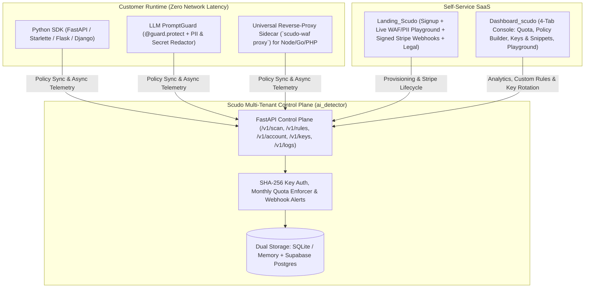

# 🛡️ Scudo WAF v1.0.0 — Hybrid Web Application & LLM Firewall Platform

[](https://www.python.org/)
[](pacchetto_scudo/pyproject.toml)
[](pacchetto_scudo/scudo_waf/py.typed)
[](.github/workflows/ci.yml)
[](pacchetto_scudo/LICENSE)

**Scudo WAF** is a production-ready, **open-core Hybrid Web Application Firewall** (`L0 Blocklist/Rate Limit -> L1 Structural De-obfuscation & Regex -> L2 Smart Cache -> L3 Calibrated Machine Learning`), **LLM Prompt Injection & PII Guard**, and **Universal Reverse-Proxy Sidecar**, paired with a **Multi-Tenant SaaS Control Plane**, **Stripe Billing Webhook engine**, and **4-Tab Self-Service Customer Console**.

---

## 🏗️ Architecture (v1.0.0)



---

## 📦 Repository Structure

| Component | Path | Purpose | Stack |
|-----------|------|---------|-------|
| **Core Python SDK, CLI & Proxy** | [`pacchetto_scudo/`](pacchetto_scudo/) | Installable `scudo-waf` (`1.0.0`) with ASGI/Flask/Django adapters, `PromptGuard` + PII/Secret Redactor, Reverse Proxy (`proxy.py`), CLI (`scudo-waf`), embedded ML models | Python, Starlette, Scikit-Learn, Joblib, Cachetools |
| **ML Pipeline (53.1k+)** | [`ai_trainer/`](ai_trainer/) | Deterministic 53,100-sample dataset generator (`dataset_waf_v2.csv`), 5-fold CV benchmarking, threshold calibration | Pandas, Scikit-Learn, FeatureUnion, CalibratedLinearSVC |
| **Multi-Tenant Control Plane** | [`ai_detector/`](ai_detector/) | `/v1/scan`, `/v1/telemetry`, `/v1/keys/provision`, `/v1/keys/rotate`, `/v1/rules`, `/v1/account`, `/v1/logs`, Slack/Discord webhooks | FastAPI, SQLite / Supabase dual storage, Pydantic, HTTPX |
| **4-Tab Security Console** | [`Dashboard_scudo/`](Dashboard_scudo/) | Customer console: Monthly Quota & Analytics, Policy & Rules Builder, API Keys & Integration Snippets, Live WAF & PII Playground | Streamlit, Plotly, Pandas, HTTPX, `scudo-waf` |
| **SaaS Onboarding & Billing** | [`Landing_Scudo/`](Landing_Scudo/) | Instant API key signup (`/api/v1/iscriviti`, `/api/v1/signup`), Live WAF + PII Playground, signed Stripe webhook (`/api/v1/stripe/webhook`), `/terms` & `/privacy` | FastAPI, Jinja2, Bootstrap 5, HMAC-SHA256, HTTPX |
| **Tests & Benchmarks** | [`pacchetto_scudo/tests/`](pacchetto_scudo/tests/), [`tests/`](tests/), [`benchmarks/`](benchmarks/) | 33 automated unit, evasion, PII, CLI/proxy, and end-to-end SaaS integration tests + latency/throughput benchmark | `unittest` / `pytest`, `httpx.ASGITransport` |
| **DevOps & PyPI Release** | [`.github/workflows/`](.github/workflows/), [`docker-compose.yml`](docker-compose.yml) | CI test matrix (Python 3.10–3.13) + automated PyPI Trusted Publisher workflow + persistent Docker Compose stack | Docker, GitHub Actions, Twine |

---

## 📊 Verified ML Evaluation & Benchmarks (v1.0.0)

### 5-Fold Stratified Cross-Validation (`42,480` Train Samples)

Evaluated via [`ai_trainer/addestra_ai.py`](ai_trainer/addestra_ai.py) on [`dataset_waf_v2.csv`](ai_trainer/dataset_waf_v2.csv) (**`53,100` strictly unique samples**: `30,000` multi-language benign including GraphQL, JSON, LaTeX, short tokens/IDs, and inequality hard-negatives + `23,100` malicious across 6 categories):

| Candidate Model | CV F1 (Mean ± Std) | CV FPR | CV ROC-AUC | Selection |
|-----------------|--------------------|--------|------------|-----------|
| **`CalibratedLinearSVC`** | **`1.0000 ± 0.0000`** | **`0.0000`** | **`1.0000`** | **Selected** (calibrated threshold `0.75`) |
| `LogisticRegression` | `1.0000 ± 0.0001` | `0.0000` | `1.0000` | Runner-up |
| `SGDLogLoss` | `1.0000 ± 0.0001` | `0.0000` | `1.0000` | Runner-up |

### Holdout Evaluation (`10,620` Unseen Test Samples)

- **Accuracy / Precision / Recall / F1 / ROC-AUC**: `1.0000` (`TN=6000, FP=0, FN=0, TP=4620`)
- **Holdout False Positive Rate**: **`0.0000`** (`0` false positives across `6,000` unseen benign inputs)
- **Per-Category Recall**: `1.0000` across `sqli`, `xss`, `path_traversal`, `command_injection`, `ssrf`, and `prompt_injection`
- **Hard-Negative Smoke Gate**: `24 / 24` tricky benign inputs allowed (`O'Brien & Sons, 123 Main St`, `"1"`, `"Mario"`, `"1 + 1 = 2 and price < 50 and rating > 4"`, GraphQL queries, Italian prose) and `12 / 12` attack probes blocked (`prob >= 0.997`)

### Measured Engine Latency & ASGI Throughput (`python benchmarks/run_benchmarks.py`)

| Benchmark | p50 | p95 | p99 | Mean |
|-----------|-----|-----|-----|------|
| **L1-Regex** (1,000 checks) | `0.0142 ms` | `0.0538 ms` | `0.1304 ms` | `0.0217 ms` |
| **L2-Cache** (1,000 cache hits) | `0.0543 ms` | `0.1358 ms` | `0.2430 ms` | `0.0674 ms` |
| **L3-ML Cold** (`inspect()` on 500 unique payloads) | `4.0401 ms` | `7.9792 ms` | `11.6897 ms` | `4.8052 ms` |
| **ASGI `WafMiddleware` Throughput** (1,000 mixed HTTP requests) | **`1,180.7 req/s`** (`0.8469 s` total) | — | — | — |

---

## ⚡ Quick Start Across Any Stack

### 1. Python SDK (`FastAPI`, `Flask`, `Django`)

```python
from fastapi import FastAPI
from scudo_waf import WafMiddleware, WafMode

app = FastAPI()
app.add_middleware(
    WafMiddleware,
    api_key="sk_live_your_key",
    mode=WafMode.BLOCK,
    blocklist_ips=frozenset({"203.0.113.99"}),
    expose_headers=True,
)
```

### 2. LLM Prompt Injection & PII/Secret Redactor (`PromptGuard`)

```python
from scudo_waf import PromptGuard

guard = PromptGuard(redact_pii=True, block_secrets=True, max_prompt_chars=4000)

@guard.protect
async def chat_completion(prompt: str) -> str:
    # Automatically blocks jailbreaks & leaked API keys (sk-..., AKIA..., JWT)
    # and masks emails, credit cards (Luhn), IBANs, Codice Fiscale, phones before LLM execution
    return await call_openai(prompt)
```

### 3. Universal Reverse-Proxy Sidecar & CLI (For Node.js, Go, PHP, Java)

```bash
pip install "scudo-waf[proxy]"

# Inspect a payload directly from terminal
scudo-waf scan "' OR 1=1 -- mario@azienda.it" --redact-pii --json

# Protect ANY upstream HTTP service without touching its code
scudo-waf proxy --upstream http://127.0.0.1:3000 --port 8081 --mode block
```

---

## 🧪 Run Locally (Docker Compose or Direct Python)

### Option A: Docker Compose (Persistent SQLite Control Plane + 4-Tab Dashboard + Landing)

```bash
cp .env.example .env
docker compose up --build
```

- **Control Plane API**: `http://localhost:8000/docs` (`/v1/scan`, `/v1/rules`, `/v1/account`, `/v1/keys/provision`, `/v1/logs`)
- **Customer Security Console (4 Tabs)**: `http://localhost:8501` (log in with an API key or click **"Explore Live Demo"**)
- **Landing, Signup & Playground**: `http://localhost:8080` (`/#playground`, `/terms`, `/privacy`)

### Option B: Run Tests & Benchmarks

```bash
pip install -e "./pacchetto_scudo[dev]"
python -m unittest discover -s pacchetto_scudo/tests -v   # 31 unit, evasion, PII, proxy, CLI & ASGI tests
python -m unittest tests/test_services_integration.py -v  # Multi-tenant Control Plane & Stripe Landing tests
python benchmarks/run_benchmarks.py                       # Reproduce v1.0.0 latency & throughput benchmarks
```

---

## 🚀 Commercial Deployment & PyPI Release Checklist

1. **Publish SDK to PyPI**: Add `PYPI_API_TOKEN` / Trusted Publisher environment `pypi` on GitHub and push tag `v1.0.0` (triggers [`.github/workflows/publish-pypi.yml`](.github/workflows/publish-pypi.yml)).
2. **Stripe Billing**: Set `STRIPE_SECRET_KEY`, `STRIPE_PRO_PRICE_ID`, and `STRIPE_WEBHOOK_SECRET` pointing Stripe webhooks to `https://<your-domain>/api/v1/stripe/webhook`.
3. **Database**: Use built-in persistent SQLite (`SCUDO_STORAGE_MODE=sqlite`) for single-node deploys or apply [`ai_detector/schema.sql`](ai_detector/schema.sql) to Supabase PostgreSQL for cloud multi-region scaling.

---

## 📄 License

MIT License — Copyright (c) 2026 Mirko Rainone (KShield).
